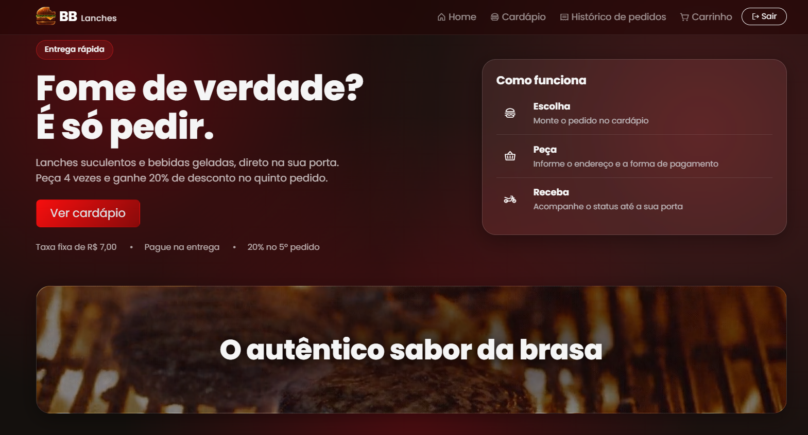

# BigBite

Sistema web de pedidos para uma lanchonete fast-food, feito com **Django**.
O cliente monta o pedido pelo site, a loja acompanha e prepara, e o entregador
confirma a entrega, cada um com sua própria tela.



## Funcionalidades

**Visitante**
- Página inicial com banner, explicação do programa de fidelidade e cardápio
- Só consegue pedir depois de fazer login

**Cliente**
- Cadastro e login por e-mail
- Carrinho (adicionar, alterar quantidade, remover)
- Checkout com endereço e forma de pagamento (dinheiro, cartão na entrega ou Pix)
- Taxa de entrega fixa de R$ 7,00
- **Fidelidade:** a cada 5 pedidos, o 5º sai com 20% de desconto nos itens
- Histórico e detalhe dos pedidos com o status em tempo real

**Loja**
- Painel com a fila de pedidos (atualiza sozinho)
- Confirma o recebimento, inicia o preparo e envia o pedido escolhendo o entregador
- Cancela pedidos e finaliza após receber o pagamento

**Entregador**
- Tela própria com endereço (link para o mapa), itens, total e forma de pagamento
- Marca "Cheguei ao destino" e "Entregue"

## Fluxo do pedido

| Status | Quem muda |
|---|---|
| Pedido feito | Cliente |
| Recebido, Em preparo, Saiu para entrega | Loja |
| Chegou, Entregue | Entregador |
| Finalizado (pagamento recebido) | Loja |

## Tecnologias

Python, Django, SQLite, Bootstrap 5 e CSS próprio (visual glassmorphism).

## Como rodar

```bash
git clone https://github.com/Ianisaque/bigbite.git
cd bigbite

python -m venv venv
# Windows
venv\Scripts\activate
# Linux/Mac
source venv/bin/activate

pip install -r requirements.txt
python manage.py migrate
python manage.py popular
python manage.py runserver
```

Acesse http://127.0.0.1:8000

## Usuários de demonstração

Criados pelo comando `python manage.py popular` (senha de todos: `bigbite123`):

| Perfil | E-mail |
|---|---|
| Loja | loja@bigbite.com |
| Entregador | entregador@bigbite.com |
| Cliente | cliente@bigbite.com |

Para testar o fluxo completo, use uma janela normal para um perfil e uma
janela anônima para outro, pois o navegador guarda um login por vez.

## Estrutura

- `contas/`: usuário customizado (login por e-mail e tipos de perfil)
- `cardapio/`: categorias, produtos, home e cardápio
- `pedidos/`: carrinho, checkout, fidelidade, painel da loja e tela do entregador
- `templates/` e `static/`: interface

## Melhorias futuras

- Avaliação dos pedidos
- Busca e filtros no cardápio
- Cupons de desconto
- Notificação por WhatsApp a cada mudança de status
- Testes automatizados