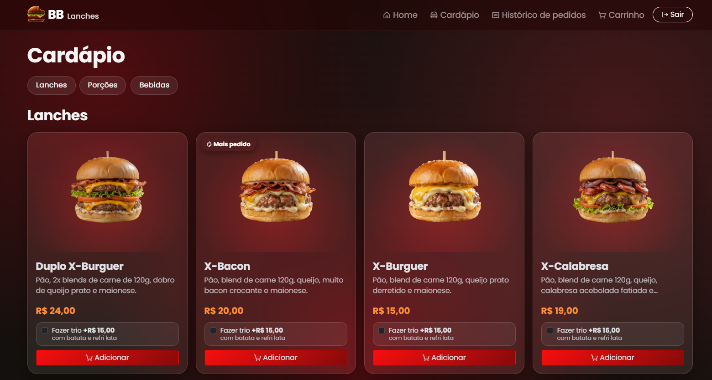
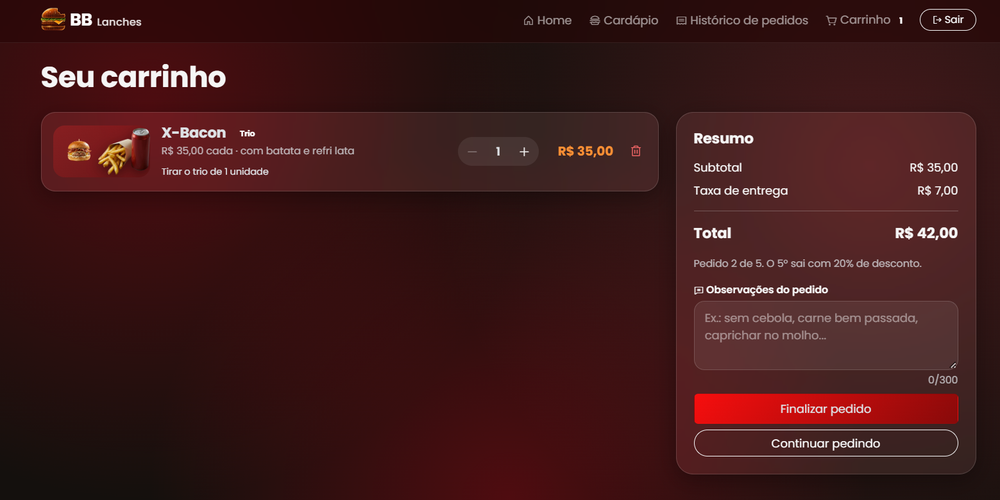
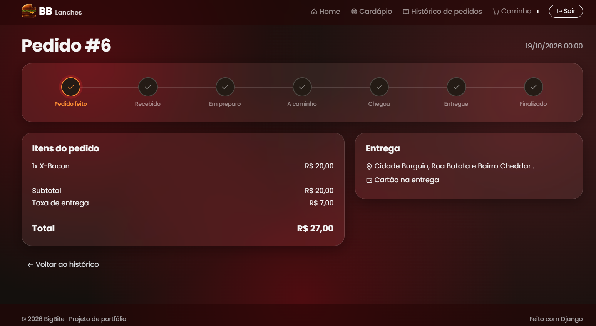
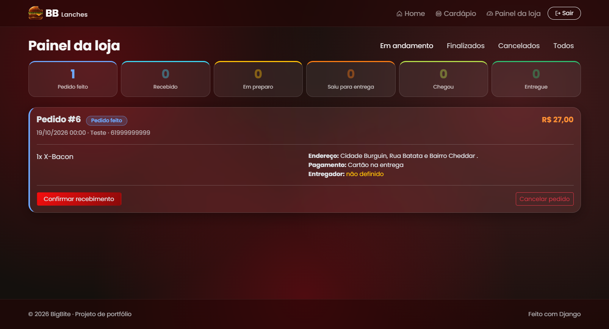
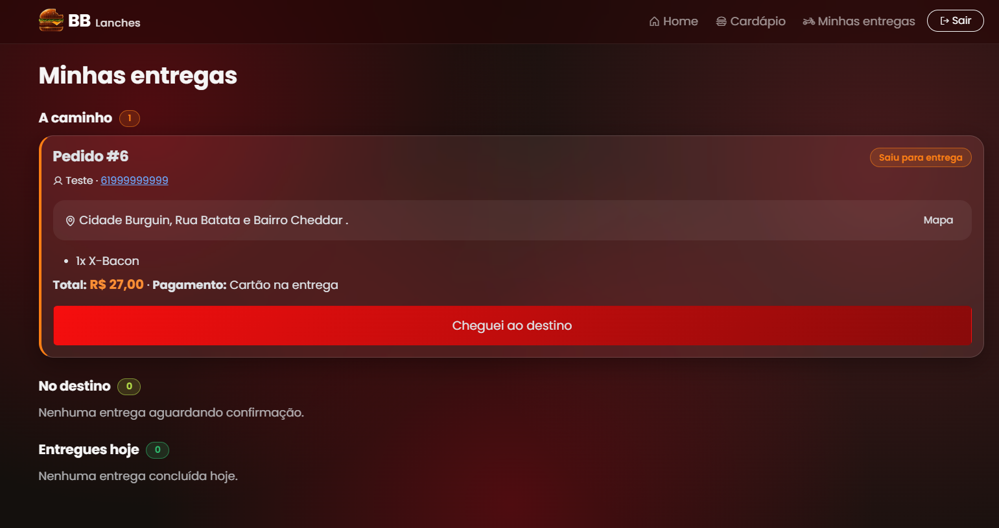
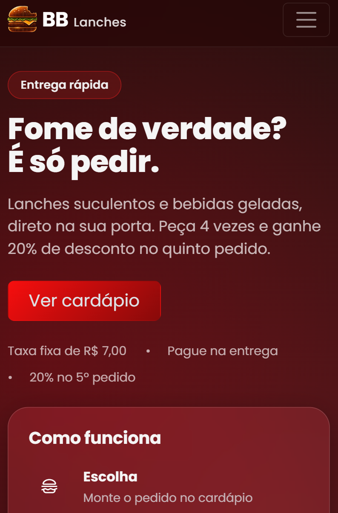

# BigBite

Sistema web de pedidos para uma lanchonete fast-food, feito com **Django**.
O cliente monta o pedido pelo site, a loja acompanha e prepara, e o entregador
confirma a entrega, cada um com sua própria tela.


## Sobre o projeto

O BigBite é uma atividade do curso de **Desenvolvedor Front-end do Senac**, feita
dentro do projeto **Transforme-se**. Ele reúne na prática o que foi estudado no
curso (HTML, CSS, layout responsivo e interface) e leva a ideia adiante com um
back-end em Django, para simular um sistema de pedidos completo.

Por ser um projeto de estudo e de portfólio, não está publicado online.

## Funcionalidades

**Visitante**
- Página inicial com banner em vídeo, explicação do programa de fidelidade e os lanches mais pedidos
- Cardápio por categorias (Lanches, Porções e Bebidas)
- Só consegue pedir depois de fazer login

**Cliente**
- Cadastro e login por e-mail
- Carrinho (adicionar, alterar quantidade, remover)
- **Trio:** qualquer lanche pode virar trio (com batata e refri lata) por +R$ 15,00, com animação do combo no carrinho
- **Observações:** campo livre no carrinho para pedidos de alteração (ex.: "sem cebola"), visível para a loja e para o entregador
- Checkout com endereço e forma de pagamento (dinheiro, cartão na entrega ou Pix)
- Taxa de entrega fixa de R$ 7,00
- **Fidelidade:** a cada 5 pedidos, o 5º sai com 20% de desconto nos itens (pedidos cancelados não contam)
- Histórico e detalhe dos pedidos com o status em tempo real

**Loja**
- Painel com a fila de pedidos (atualiza sozinho)
- Confirma o recebimento, inicia o preparo e envia o pedido escolhendo o entregador
- Cancela pedidos e finaliza após receber o pagamento

**Entregador**
- Tela própria com endereço (link para o mapa), itens, observações, total e forma de pagamento
- Marca "Cheguei ao destino" e "Entregue"

## Telas

| Cardápio | Carrinho com trio |
|---|---|
|  |  |

| Acompanhamento do pedido | Painel da loja |
|---|---|
|  |  |

| Entregador | No celular |
|---|---|
|  |  |

## Fluxo do pedido

| Status | Quem muda |
|---|---|
| Pedido feito | Cliente |
| Recebido, Em preparo, Saiu para entrega | Loja |
| Chegou, Entregue | Entregador |
| Finalizado (pagamento recebido) | Loja |

## Tecnologias

- Python, Django e SQLite
- Bootstrap 5 e CSS próprio (visual glassmorphism, tema vermelho)
- [Phosphor Icons](https://phosphoricons.com/) para os ícones
- Pillow, usado pelo comando `popular` para otimizar as fotos dos produtos
- Animações em CSS puro (logo que se retrai, combo do trio) e um pouco de JavaScript no carrinho
- Layout responsivo, pensado também para o celular

## Como rodar

```bash
git clone https://github.com/Ianisaque/bigbite.git
cd bigbite

python -m venv venv
# Windows
venv\Scripts\activate
# Linux/Mac
source venv/bin/activate

pip install -r requirements.txt
python manage.py migrate
python manage.py popular
python manage.py runserver
```

Acesse http://127.0.0.1:8000

## Usuários de demonstração

Criados pelo comando `python manage.py popular` (senha de todos: `bigbite123`):

| Perfil | E-mail |
|---|---|
| Loja | loja@bigbite.com |
| Entregador | entregador@bigbite.com |
| Cliente | cliente@bigbite.com |

Para testar o fluxo completo, use uma janela normal para um perfil e uma
janela anônima para outro, pois o navegador guarda um login por vez.

## Testes

```bash
python manage.py test
```

Cobrem o carrinho, o trio, as observações, o checkout, a fidelidade, as
permissões de cada perfil e o fluxo de status do pedido.

## Estrutura

- `contas/`: usuário customizado (login por e-mail e tipos de perfil)
- `cardapio/`: categorias, produtos, home e cardápio
- `pedidos/`: carrinho, checkout, fidelidade, painel da loja e tela do entregador
- `templates/` e `static/`: interface

## Melhorias futuras

- Avaliação dos pedidos
- Busca e filtros no cardápio
- Cupons de desconto
- Notificação por WhatsApp a cada mudança de status
